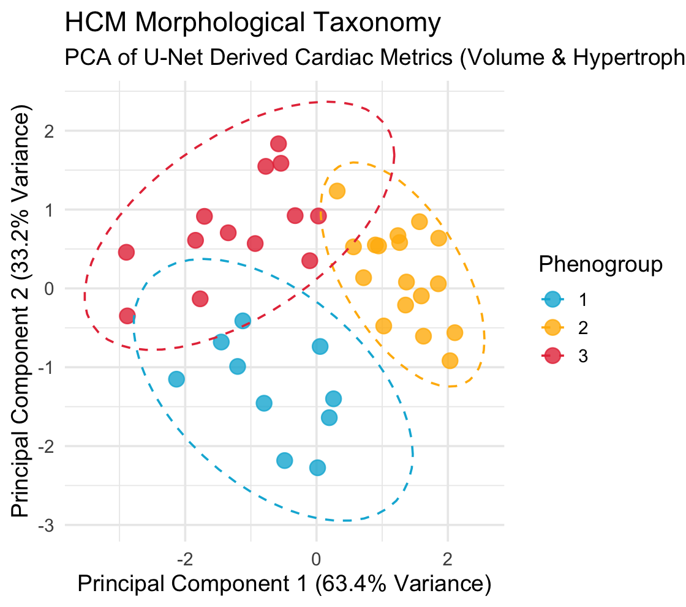

# Deep Cardiac Phenotyping: 3D MRI Segmentation and Morphological Taxonomy

**Author:** Nuru Khaliel, MSc Artificial Intelligence in the Biosciences  
**Tech Stack:** Python (PyTorch, MONAI), R (ggplot2, cluster)  

## Executive Summary
This repository contains an end-to-end clinical bioinformatics pipeline designed to characterize disease heterogeneity in Hypertrophic Cardiomyopathy (HCM). The architecture bridges computer vision and statistical taxonomy by automatically segmenting 3D cardiac MRI scans and clustering the resulting physical metrics into distinct morphological phenogroups. 

To ensure clinical diagnostic safety, the model was subjected to a robustness evaluation, testing its resilience against simulated scanner degradation and patient motion artifacts.

## 1. Deep Learning Segmentation Pipeline
The initial phase of the pipeline processes raw clinical HDF5/NIfTI cardiac arrays into `(16, 128, 128)` 3D tensors. A 3D U-Net was trained using PyTorch and MONAI to automatically delineate the left ventricular cavity and the surrounding myocardium.

**Clinical Robustness Guardrails:**
To validate that the U-Net learned true spatial anatomy rather than over-fitting to perfect pixel intensities, adversarial Gaussian noise (Mean=0, Std=0.5) was injected into the unseen validation cohort. The model maintained a robust baseline, suffering only an **11.7% degradation** under stress.

### Segmentation Results
*Left: Original MRI slice. Center: Ground Truth Annotations. Right: 3D U-Net Prediction.*

## 2. Morphological Feature Extraction & Taxonomy
The predicted 3D voxel masks were computationally translated into physical volumetric measurements. A specific proxy **Hypertrophy Index** (myocardial wall thickness relative to left ventricular chamber size) was engineered to mathematically represent the primary indicator of HCM.

These metrics were passed into R for statistical evaluation. Principal Component Analysis (PCA) captured **96.6%** of the total morphological variance across two principal components. K-means clustering was then deployed to map the patient data into three structural phenogroups, successfully isolating severe hypertrophy from standard cardiac morphologies.

### Phenotypic Clustering
*K-means clustering and PCA mapping of U-Net derived cardiac metrics.*

## Repository Contents
* `cardiac_segmentation_unet.ipynb`: The complete Python deep learning pipeline, custom data loaders, and noise-injection robustness evaluation.
* `morphological_clustering.R`: The R script for PCA dimensional reduction and K-means disease taxonomy plotting.
* `hcm_morphology_metrics.csv`: The extracted clinical metrics derived from the U-Net predictions.
